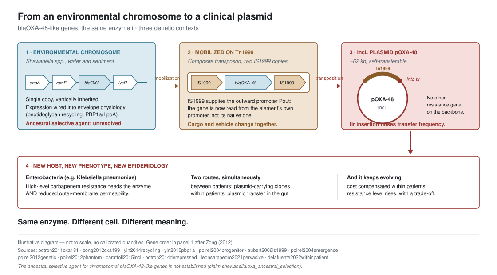

# From *Shewanella* to the clinic: the OXA-48 story

**What this case teaches:** a molecular capability can acquire a new clinical
meaning when mobility moves it into a new genetic, cellular and ecological
context. The chemistry does not have to change for the consequence to.

The spine of the case:

> environmental physiology → native molecular capability → chromosomal
> context → mobilization → transposon (Tn*1999*) → plasmid (IncL, pOXA-48) →
> new host → new phenotype → selection + horizontal transfer → clinical AMR

Each arrow is a different kind of biological event, and none of them is
contained in the sequence of the gene.

---

## Before you read on: commit to an answer

An OXA-like β-lactamase gene sits on the chromosome of a *Shewanella* species
in river sediment. **What phenotype do you expect that organism to have?**

Decide before opening the answer. A reader who has committed experiences what
follows as a correction; a reader who has not experiences it as information,
and only the first changes a model. See
[`../docs/pedagogy-conventions.md`](../docs/pedagogy-conventions.md).

What the evidence shows

**Almost certainly not what you predicted, in either direction.**

The gene is functional. BlaA — the *S. oneidensis* class D enzyme also called
OXA-54 [@sher2025shewanella] — raises the minimum inhibitory concentration for
three **penicillins**: ampicillin 16, penicillin 32 and carbenicillin 64
µg/ml in the wild type, against <1 for each in a *blaA* deletion mutant
(Yin 2013, Table 2) [@yin2013blaa]. So "no phenotype, just an ancestral gene"
is wrong.

But "carbapenem resistance, like a clinical OXA-48 producer" is also wrong.
OXA-48-like enzymes hydrolyse carbapenems only weakly, and the clinical
phenotype additionally requires reduced outer-membrane permeability
[@poirel2012phantom].

**And the strangest part is one almost nobody predicts.** Ampicillin *lyses*
*S. oneidensis* at 0.49–6.25 µg/ml but **not** at 50 µg/ml [@yin2013blaa].
The organism dies at a low dose and survives a high one. The mechanism is
that induction is dose-gated: a high dose strongly induces *blaA*, which
clears the drug quickly, while a low dose induces it only weakly, so the
drug persists and the cells lyse. The authors attribute the lysis to slow
removal of the agent.

That is the answer worth keeping. A gene we would label "antibiotic
resistance" produces, in its native host, a dose–response that runs backwards
relative to the intuition the label creates.

**`NOT COMPARABLE` — a phenotype discrepancy worth seeing.** Poirel et al.
report that *S. oneidensis* MR-1 was "susceptible to all β-lactams" across a
14-drug panel [@poirel2004progenitor], which reads as a flat contradiction of
the MICs above. Before calling it one, apply scope before status: different
laboratories, different drug panels, different media, and no agreed criterion
for what counts as resistance in this organism. Clinical breakpoints are
defined for named pathogens, not for *Shewanella*, and they differ between
standards, so "susceptible" and "resistant" are not fixed properties of a
number here.

Stay with what was measured. Deleting *blaA* drops the ampicillin, penicillin
and carbenicillin MICs from 16, 32 and 64 µg/ml to below 1, and at low
ampicillin concentrations the wild type lyses while the drug persists. Those
are the observations. The disagreement is about the word applied to them, and
that word is not something the primary data settles.

## 1. Environmental physiology

*Shewanella* species are Gram-negative bacteria of aquatic sediments and water
columns, where they are known for respiratory versatility. They are not
clinical organisms by origin. Their relevance here is that they are an
environmental reservoir that carries chromosomal *bla*OXA-48-like
genes.

**Source.** *S. xiamenensis* was identified as the progenitor of the
*bla*OXA-181 gene by PCR screening of environmental samples
[@potron2011oxa181]. A chromosomal *bla*OXA-48-like variant,
*bla*OXA-199, was later found in *S. xiamenensis*, together with
*bla*OXA-48b in the type strain [@zong2012oxa199]. Culture-independent
sequencing of river and estuarine water found far more *bla*OXA-48-like
diversity than clinical settings had shown, including 50 previously unreported
variants [@tacao2017culture].

## 2. Native molecular capability

The ancestor of OXA-48 is a chromosomal class D β-lactamase of *Shewanella*.
Two species do different evidential jobs on this page and should not be fused
into one organism: **physiology and regulation come from *S. oneidensis***,
whose chromosomal class D β-lactamase BlaA is also called OXA-54, while
**genomic context comes from *S. xiamenensis***, where the
*bla*OXA-48-like genes and their neighbours were characterised.

In *S. oneidensis*, BlaA raises the MIC for three **penicillins** —
ampicillin, penicillin and carbenicillin — by at least an order of magnitude
against a deletion mutant [@yin2013blaa], and its expression is genuinely
regulated: not
through the canonical AmpR/AmpC paradigm, which *Shewanella* lacks, but
through peptidoglycan-recycling enzymes (AmpG, NagZ) and through PBP1a and its
cofactor LpoA [@yin2014recycling; @yin2015pbp1a].

**Interpretation.** The gene sits inside the cell's own envelope physiology.
Inactivating *mrcA* or *lpoA* — genes of peptidoglycan synthesis, not of
resistance — strongly changes β-lactamase expression [@yin2015pbp1a]. In its
native context the enzyme is wired into cell-wall metabolism, not into a
resistance cassette.

**Unresolved: what selected it.** We do **not** know what historically
selected these chromosomal oxacillinases in environmental *Shewanella*.
Candidate explanations include environmental β-lactams produced by competing
organisms, a role in cell-wall turnover or signalling, or neutral retention of
an ancient gene family. Resistance genes much older than clinical antibiotic
use are documented — functional β-lactam, tetracycline and glycopeptide
resistance determinants were recovered from 30,000-year-old permafrost
[@dcosta2011ancient] — and environmental resistance genes need not have
arisen under therapeutic selection [@martinez2008natural]. That establishes
that *resistance predates therapy*. It does **not** establish what the
selective agent was for this particular gene in this particular lineage.
This project records that question as open (see
`claim.shewanella.oxa_ancestral_selection` in
[`../evidence/claims.yml`](../evidence/claims.yml)).

## 3. Chromosomal context

In *Shewanella*, the gene is chromosomal, single-copy, and flanked by ordinary
housekeeping neighbours. In *S. xiamenensis* the *bla*OXA-48-like
gene lies next to a peptidase gene, *sprT*, endonuclease I (*endA*) and an rRNA
methyltransferase upstream, and a LysR-type regulator and an acetyl-CoA
carboxylase gene downstream [@zong2012oxa199].

**Interpretation.** In this native chromosomal context, transmission is
predominantly tied to the host lineage rather than to an autonomous mobile
element, so the gene's distribution largely tracks the distribution of its
host species.

## 4. Mobilization: the insertion sequence

IS*1999*, an IS*4*-family element, is found inserted immediately upstream of
*bla*OXA-48 [@poirel2004emergence]. It supplies an outward-directed
promoter, Pout, that drives expression of the downstream β-lactamase
gene, and IS*1999*-based composite transposons can transpose onto a conjugative
plasmid in experiment [@aubert2006is1999].

**Interpretation.** Mobilization changes **two** things at once: it moves the
gene, and it changes how much of the gene product is made, because the new
promoter is the insertion sequence's own. The cargo and the vehicle are both
altered by the same event.

## 5. The transposon: Tn*1999*

Two IS*1999* copies flanking *bla*OXA-48 form the composite transposon
Tn*1999*, which is the unit found carrying *bla*OXA-48 onto plasmids
[@poirel2012genetic].

**Source caveat.** In the transposition assay of Aubert et al., transposition
of the putative natural Tn*1999* itself was below the detection limit, although
IS*1999* and laboratory-built IS*1999* composite transposons did transpose
[@aubert2006is1999]. The genetic evidence that Tn*1999* is the mobile unit is
structural (where the element is found, and what it is flanked by), not a
measured transposition rate.

## 6. The plasmid: IncL pOXA-48

Complete sequencing of pOXA-48a from a *Klebsiella pneumoniae* isolate showed
an IncL/M-type backbone carrying *bla*OXA-48 inside Tn*1999*, and no
other antibiotic resistance gene [@poirel2012genetic]. The plasmid is a ~62 kb
self-transferable element, and the global spread of *bla*OXA-48 is
largely the spread of this one plasmid [@poirel2012phantom]. The IncL/M group
was subsequently split, with the pOXA-48 lineage assigned to IncL
[@carattoli2015incl].

A detail worth dwelling on: in pOXA-48a, Tn*1999* is inserted into *tir*, the
gene encoding a transfer inhibition protein, and this insertion raises the
plasmid's conjugative transfer frequency [@potron2014derepressed].

**Interpretation.** The plasmid acquired the OXA-48 cargo in a configuration
that also disrupted a brake on conjugative transfer. The plasmid carrying the
gene is not a neutral container: that insertion raises its transfer frequency
[@potron2014derepressed]. Note what is and is not claimed here — the
configuration is observed and its effect on transfer was measured, but the
history is not reconstructed from a directly observed event.

## 7. New host, new phenotype

OXA-48 was first characterised in *K. pneumoniae* strain 11978 from Turkey
(isolated 2001), which was resistant to all β-lactams including carbapenems
[@poirel2004emergence]. The chromosomal *S. oneidensis* enzyme OXA-54 shares
92% amino acid identity with plasmid-encoded OXA-48 [@poirel2004progenitor].

But the clinical phenotype is not the enzyme alone. OXA-48-like enzymes
hydrolyse penicillins at a high level and carbapenems only weakly, and spare
broad-spectrum cephalosporins; high-level carbapenem resistance appears when
enzyme production is combined with a permeability defect
[@poirel2012phantom]. Strain 11978 indeed lacked a ~36 kDa porin
[@poirel2004emergence].

> **Same enzyme family. Different cell. Different meaning.**

An enzyme embedded in *Shewanella* envelope physiology becomes, in an
enterobacterium with reduced outer-membrane permeability and a high-expression
promoter, a carbapenemase of clinical consequence. Nothing about the catalytic
chemistry had to change.

## 8. Selection and horizontal transfer in the clinic

pOXA-48 spreads by both routes at once. Combining epidemiological data from
more than 9,000 patients with genomes from 250 enterobacterial clones, a
two-year hospital study found frequent patient-to-patient transmission of
pOXA-48-carrying clones **and** pervasive within-patient transfer of the
plasmid between enterobacteria in the gut microbiota [@leonsampedro2021pervasive].

Fitness effects of pOXA-48_K8 across wild-type gut enterobacteria were mostly
small, and beneficial in several isolates; in a population model, that
variability itself widened the conditions for plasmid persistence, with
persistence increasing with host diversity and depending less on conjugation
[@alonsodelvalle2021variability]. Within patients, the plasmid continues to
evolve: compensatory evolution of its fitness cost, and increases in
resistance level, were observed, with a trade-off between resistance and host
fitness [@delafuente2022withinpatient].

## 9. What the case does and does not show

**Teaching points.**

1. **Resistance predates therapeutic antibiotics.** The chemistry was already
   there, in environmental organisms, before clinical use [@dcosta2011ancient;
   @martinez2008natural; @potron2011oxa181].
2. **The "ARG" label is phenotypically valid but historically incomplete.**
   BlaA really does protect its native host against penicillins
   [@yin2013blaa], so calling it a resistance gene is not simply a projection.
   What the label does not carry is *why the gene was retained*: its
   expression is wired into cell-wall metabolism [@yin2014recycling;
   @yin2015pbp1a], and the ancestral selective reason is unresolved.
3. **Same enzyme family, different host phenotype.** OXA-54 and OXA-48 share
   92% amino-acid identity: relatives, not the same protein. Clinical
   carbapenem resistance requires the enzyme plus a permeability context
   [@poirel2012phantom].
4. **Mobilization changes cargo and vehicle.** IS*1999* supplies the promoter
   [@aubert2006is1999]; the Tn*1999* insertion into *tir* raises transfer
   frequency [@potron2014derepressed].
5. **The origin of an AMR problem is not the origin of the chemistry.** The
   clinical problem has an origin — a mobilization, a plasmid backbone, a
   permissive host, a hospital. The enzyme has a much older and separate one.

**What is unresolved.** The ancestral selective agent for chromosomal
*bla*OXA-48-like genes in *Shewanella*. Also: the direction and
timing of the original mobilization event is inferred from gene content and
identity, not observed.

**Where this generalises.** This case states the specific version of a claim
that the concept pages state generally:

> Same enzyme family. Different cell. Different meaning.
> → **Same plasmid. Different context. Different fate.**

See [`../concepts/copy-carry-spread.md`](../concepts/copy-carry-spread.md) for
the routes by which that fate is decided.

## Figure

Rebuild instructions: [`../figures/README.md`](../figures/README.md).

## How this can be misread

The figure and the narrative above both compress, and compression invites
inferences the evidence does not support. Status vocabulary:
[`../docs/pedagogy-conventions.md`](../docs/pedagogy-conventions.md).

| Tempting reading | Status | Better interpretation |
| --- | --- | --- |
| "OXA-48 evolved in *Shewanella* to resist carbapenems." | **False as stated; the underlying question is unresolved** | *Clinical* carbapenem use cannot explain an ancestral environmental history. But natural carbapenems do exist — thienamycin from *Streptomyces cattleya* [@kahan1979thienamycin] and SQ 27,860 from *Serratia* and *Erwinia* species [@parker1982sq27860] — so "there were no carbapenems in the environment" would also be wrong. Whether any β-lactam was the selective agent for these genes is not established (`claim.shewanella.oxa_ancestral_selection`). |
| "Native OXA-like genes are therefore not really resistance genes." | **False** | They do confer β-lactam resistance in their native hosts [@sher2025shewanella; @yin2015pbp1a]. The point is narrower: the *clinical* meaning depends on host context, not that the native gene is inert. |
| "Mobilization only moved the gene to a new location." | **Misleading** | IS*1999* supplies the outward-directed promoter from which the β-lactamase is read [@aubert2006is1999], so the expression context changed too, not only the address. |
| "The Tn*1999* insertion into *tir* and the original capture of the gene were one observed historical event." | **Unsupported** | The present configuration is known: Tn*1999* carrying *bla*OXA-48 sits within *tir*, and plasmids in that configuration transfer at higher frequency [@potron2014derepressed; @poirel2012genetic]. The order and timing are reconstructed, not observed. |
| "The same enzyme gives the same phenotype in any host." | **False** | Host physiology decides. High-level carbapenem resistance needs the enzyme plus reduced outer-membrane permeability [@poirel2012phantom; @poirel2004emergence]. |
| "The chromosome → transposon → plasmid → clinic arrows are a measured lineage." | **Illustrative** | The figure orders *contexts*, not a reconstructed descent. No arrow is a dated transition, and the panel shows a subset of the gene neighbourhood. |

### A note the figure cannot carry

The regulation of the native gene is not uniform across studies. Induction of
OXA-54 by imipenem or cefoxitin could not be demonstrated in *S. oneidensis*
MR-1 [@poirel2004progenitor], while *blaA* is strongly induced by high-dose
ampicillin [@yin2013blaa] and is regulated through PBP1a/LpoA and
peptidoglycan-recycling enzymes [@yin2015pbp1a; @yin2014recycling]. These are
compatible — different inducers, different assays — but "the gene is
inducible" is too flat a summary to be worth teaching
(`claim.shewanella.blaa_regulation_not_uniform`: `layer: interpretation`,
`status: supported` — the reports are not comparable, so they do not
establish a disagreement).
