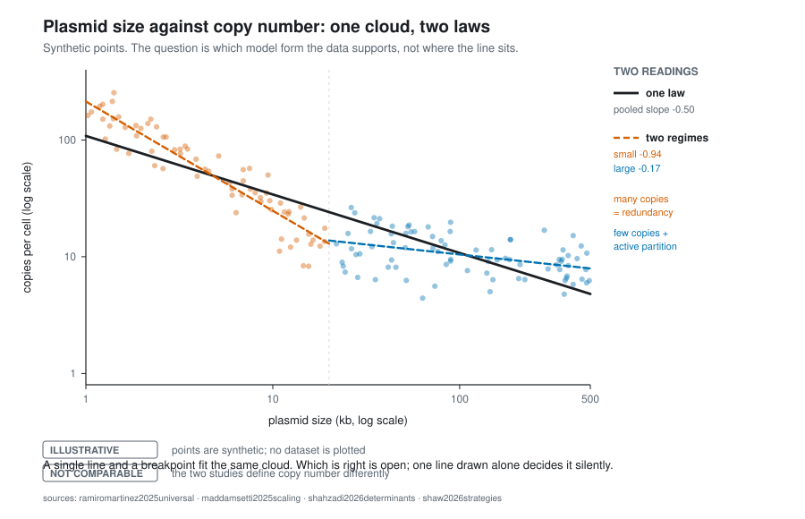

# Plasmid size and copy number: one cloud, two laws

Small plasmids tend to sit at high copy number and large ones at low copy
number. That much is old and not in dispute. What the relationship *is* — and
whether it is one relationship at all — is open, and the way it is open makes
it a better teaching case than a settled number would be.



**`ILLUSTRATIVE`** — the points in that figure are synthetic, generated by a
seeded generator in
[`figures/source/size_copy_number_two_readings.py`](../figures/source/size_copy_number_two_readings.py).
No dataset is plotted and no published point is reproduced. Both lines are
least-squares fits to the points shown, so the contrast is a property of the
drawn data rather than of the draughtsman.

## Two published readings

Two 2025 studies fit a **single power law** across large collections of
plasmids [@ramiromartinez2025universal; @maddamsetti2025scaling]. A 2026
preprint argues that a **segmented fit over two strategies** is the better
model, and that both the form and the interpretation of the law are disputed
[@shaw2026strategies].

The segmented reading is not a new idea to a reader of this repository. It is
the same pair of solutions that appears whenever inheritance is the problem:

```text
small plasmid, no active partition      large plasmid, active partition
inheritance depends on numbers          machinery handles inheritance
  ↓                                       ↓
many copies → redundancy                few copies → deliberate inheritance
  ↓                                       ↓
strong inverse scaling with size        much weaker relationship
```

So the dispute is about whether one exponent is averaging over two mechanisms.
A reader who has met the two solutions already has the alternative hypothesis;
what they have not been given is the question.

## Why this is `NOT COMPARABLE` and not `contested`

It is tempting to file this as a controversy. Under **scope before status** in
[`../evidence/evidence-levels.md`](../evidence/evidence-levels.md), it is not
one. The first gate of that decision tree asks whether the findings make the
same claim under comparable conditions — same assay, estimator, definition —
and here the answer is no:

| | Copy number means |
| --- | --- |
| [@ramiromartinez2025universal] | copies per cell, from read-depth ratios across nine genera |
| [@maddamsetti2025scaling] | *"the number of plasmid copies per the longest chromosome per cell"* |

Those are different quantities. Under fast growth a cell holds several
chromosome equivalents, so they differ by a growth-rate-dependent factor — and
in any growth competition that factor is itself under selection. A third
value, the $C$ in this repository's
[copy-number model](../models/copy-number-burden/README.md), is copies per
cell again and is not interchangeable with the second.

`contested` would say two studies disagree about one quantity. The honest
statement is that they are measuring different quantities with different
estimators, which is why the comparison carries **`NOT COMPARABLE`** instead.

That is also the more useful lesson. This repository's measurement-chain
argument — that `PCN`, carrier abundance, total molecules and barcode count
are different numbers — turns out to apply to the literature about plasmids as
readily as to an assay.

## What refitting the published data adds

Both datasets above are public, and this repository reanalyses them in
[`../reproductions/ramiro-scaling/`](../reproductions/ramiro-scaling/) —
[`REPORT.md`](../reproductions/ramiro-scaling/REPORT.md) for the argument,
[`RESULTS.md`](../reproductions/ramiro-scaling/RESULTS.md) for the record,
and [`../docs/open-findings.md`](../docs/open-findings.md) for the claims
that have been corrected or withdrawn, of which there are several. None of
the numbers below is in the figure at the top of this page, which is still
synthetic.

Three things that reanalysis settles, and one it does not.

**A baseline that gives the exponent a meaning.** A slope of exactly −1 is
the value at which copy number falls just fast enough to hold total plasmid
DNA constant: twice the plasmid, half the copies, same DNA. Read against
that, the question stops being "is the exponent −0.7 or −0.9" and becomes
*how much of each size increase the host pays back*. Correcting for the
read-count floor, which censors along exactly this axis, the pooled slope is
**−0.680** — so doubling plasmid size multiplies DNA load by about **1.25**.
Compensation is real and partial. A single number for how partial is more
useful to a student than a contested exponent.

**The segmented fit is not what singles the relationship out.** A hinge
beats a straight line comfortably. So does a smooth curve, and the
comparison that matters is hinge against smooth *at the same number of
parameters*. At matched complexity a plain cubic fits better than the
hinge — by 19.0 AIC units on [@ramiromartinez2025universal] and 21.7 on
[@maddamsetti2025scaling] over the range the two datasets share — and
five-fold and leave-one-lineage-out cross-validation prefer the cubic on
both. The breakpoint's own 95% interval spans roughly a factor of four.

This is a test of **shape, not of mechanism**, and the distinction carries
the weight here. Two inheritance strategies can be perfectly real and still
not produce a detectable kink: a gradual handover between them gives a
smooth curve. What the comparison rules out is reading the *fit* as
evidence of a threshold. It says nothing about whether the two solutions
exist, and this repository's own pages argue that they do.

**The growth-rate factor named above can be measured, and it is not the
explanation.** The objection in the previous section — that a fast-growing
cell holds several chromosome equivalents, so the two studies' quantities
differ by a growth-rate-dependent factor — has a testable consequence. That
factor is one number per sequenced genome, shared by every replicon in it,
so giving each assembly its own intercept absorbs it exactly. Do that and
the curvature stays. The `NOT COMPARABLE` verdict therefore stands for the
two studies' *numbers*, which really are different quantities; it does not
extend to the shape, which survives the denominator being allowed to float.

**What stays `UNRESOLVED`: the range the relationship should be read over.**
Over the span both datasets cover, the curve is smooth. Over the wider span
only one of them reaches — plasmids past a tenth of a chromosome, and
plasmids below one copy per chromosome — a hinge does fit better, and that
is not an artefact of the read-count floor, which binds small plasmids
rather than large ones and whose tenfold tightening leaves the result
standing. But the support for it is concentrated in a small part of the
sample rather than spread across it, so it is a statement about part of a
dataset and not yet a statement about plasmids. Which range is the right one
is a question about what a copy number below one means, and that is not
settled by any model-selection table.

## What a reader may take from this

| you may conclude | you may not conclude |
| --- | --- |
| copy number and size are inversely related across the range sampled | that one exponent describes all plasmids |
| the relationship is much weaker among large plasmids | that a published slope transfers to a particular plasmid |
| at least two model forms fit the published data | that the matter is settled either way |
| the two 2025 studies measured different quantities | that either is wrong |
| over the range both datasets share, a smooth curve fits at least as well as a segmented one at equal complexity | that a segmented fit is wrong, or that two inheritance strategies are not real — a shape test is not a mechanism test |
| copy number compensates only partly for size: the corrected slope sits well short of the −1 that would hold DNA load constant | that this exponent transfers to a particular plasmid, or outside the range sampled |
| the curvature is not an artefact of counting copies per chromosome rather than per cell | that the two studies' numbers can now be compared — they still estimate different quantities |

## Sources

Held centrally in [`../evidence/references.bib`](../evidence/references.bib).
The 2026 modelling work [@shahzadi2026determinants] shares two authors with
[@maddamsetti2025scaling], so the three studies are not three independent
observations; that is recorded here because a slide listing them in sequence
implies more corroboration than exists.

---

So there are three papers here and, between them, neither a corroboration nor
a disagreement: two share authors and observations, and the third is not
estimating the same quantity. That is not a gap in the reading. It is the
state of the question.

A disagreement needs a shared question first.
